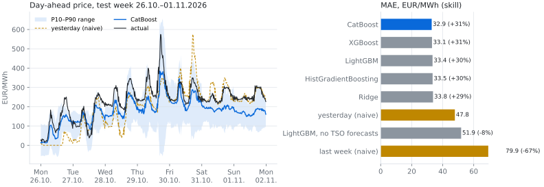
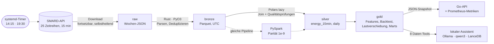

# Ruhrwatt


[English](README.md) · **Deutsch**

Day-Ahead-Strompreise und Einsparungen durch Lastverschiebung für die NRW-Industrie, auf
Basis öffentlicher SMARD-Daten: ein Rust-Parser, Polars-Pipelines mit Qualitätsprüfungen,
eine nachweislich identische Spark-Version, Prognosemodelle, ein lokaler deutschsprachiger
Assistent und eine kleine Go-API. Die Daten aktualisieren sich zweimal täglich selbst.

- **Prognose:** CatBoost sagt die Viertelstundenpreise von morgen mit einem **mittleren Fehler
  von 31,3 EUR/MWh voraus, 36 % weniger als „wie gestern“** (Walk-Forward-Backtest,
  wöchentlich neu trainiert, 8 Modelle auf identischen Zeilen). Das P10–P90-Band enthält 77 %
  der tatsächlichen Preise (Ziel: 80 %). Ohne die Wind- und PV-Prognosen der
  Übertragungsnetzbetreiber ist das beste Modell nicht besser als die Basislinie: Daher kommt
  die Prognosegüte.
- **Tempo:** Der Rust-Parser für die Bronze-Schicht ist **9× schneller** als dieselbe Logik in
  Python + pyarrow (350 Tsd. Zeilen, 2 Kerne; `make bench`), die Ergebnisse werden vor der
  Zeitmessung auf Gleichheit geprüft.
- **Spark:** Die PySpark-Pipeline stimmt in jeder Tabelle bis auf 1e-9 mit Polars überein. Auf
  einem Rechner ist Polars trotzdem 7–44× schneller und deshalb der Standard.
- **Assistent:** Ein lokales qwen3:14b beantwortet deutsche Fragen über 8 Daten-Tools: 26 von
  28 Testantworten vollständig richtig, keine falsch, jede Zahl wird gegen die Tool-Ausgabe
  geprüft.



## Architektur



| Schicht | Was passiert | Code |
|---|---|---|
| raw | SMARD-Wochendateien, atomare Schreibvorgänge, erneutes Laden von Wochen, die SMARD noch füllt | `download/` |
| bronze | Der Rust-Kern parst, sortiert, dedupliziert und zählt Lücken parallel; typisiertes Parquet | `crates/`, `bronze/` |
| silver | 25 Zeitreihen auf einem lückenlosen 15-Minuten-Raster; Prüfungen stoppen fehlerhafte Daten (Preisbereich, PV nachts null, Prognosen korrelieren mit Ist-Werten, ...) | `silver/` |
| gold | Sommerzeit-sichere Lag-Features ohne Blick in die Zukunft, Walk-Forward-Modellvergleich, optimale Lastverschiebung innerhalb des Tages, monatlicher Markt-Mart | `gold/` |
| serving | Go-API (nur Standardbibliothek, Distroless-Image) und der Assistent lesen aus gold | `api/`, `rag/` |

## Schnellstart

Benötigt [uv](https://docs.astral.sh/uv/) und [rustup](https://rustup.rs); `uv sync` kompiliert
die Rust-Erweiterung. Spark braucht Java 17/21, der Assistent [Ollama](https://ollama.com) mit
≤ 16 GB VRAM.

```bash
uv sync && uv run pytest -m "not spark"   # bauen + Offline-Tests
make smard-all                            # alle Zeitreihen seit 2025-01-01 laden
make pipeline                             # bronze -> silver -> gold -> Serving-Snapshot
make backtest                             # Modellvergleich; danach `make readme-chart`
make ask Q="Wann war der Strom gestern am billigsten?"
make api PORT=8090 && make api-check PORT=8090
```

<details>
<summary>Alle Befehle</summary>

```bash
make bronze | silver | gold    # einzelne Schichten
make lab                       # JupyterLab; Einstieg: notebooks/01_explore_silver.ipynb
make spark                     # silver + gold-Features mit PySpark -> data/spark
make spark-parity              # zeigt, dass Spark und Polars identische Tabellen liefern
make bench                     # Rust- vs. reiner Python-Parser
make bench-spark               # Polars vs. Spark mit 2 / 10 / 25 Jahren synthetischer Daten
make rag-setup && make rag-index   # Modelle laden, Doku einbetten
make chat | rag-eval | rag-batch   # interaktiv, Eval mit bekannten Antworten, deutscher Fragensatz
make up                        # Docker; Profile in docs/devops.md
make timer-install             # tägliche Aktualisierung um 14:15 und 19:30 (systemd-User-Timer)
make readme-chart              # docs/img/backtest.svg aus dem letzten Backtest
```

</details>

<details>
<summary>Aufbau des Repositorys</summary>

```
src/ruhrwatt/
  cli.py              `ruhrwatt smard|silver|gold|spark|rag ...`
  download/smard.py   SMARD-Downloader (fortsetzbar, atomar, lädt unfertige Wochen neu)
  bronze/smard.py     raw -> bronze-Parquet über den Rust-Kern
  bronze/reference.py reine Python-Referenz für Tests und Benchmark
  silver/energy.py    bronze -> energy_15min + energy_daily (Polars, lazy)
  silver/gates.py     Qualitätsprüfungen (Preisbereich, Amprion <= DE, PV nachts null, ...)
  gold/features.py    Day-Ahead-Prognosefeatures (kein Blick in die Zukunft, sommerzeit-sicher)
  gold/backtest.py    Walk-Forward-Vergleich von 8 Modellen + kalibrierte P10/P90-Bänder
  gold/shift.py       optimale Lastverschiebung innerhalb des Tages für NRW-Anlagenprofile
  gold/mart.py        gold-Tabellen inkl. monatlichem Markt-Mart
  gold/serving.py     JSON-Snapshots für die Go-API
  spark/              PySpark silver + gold-Features, Paritätsprüfung gegen Polars
  rag/                lokaler Assistent: Ollama-Client, Daten-Tools, Doku-Index, Agent, Eval
crates/ruhrwatt-core/ Rust (PyO3): paralleles Parsen, Deduplizieren, Qualitätszähler, Parquet
api/                  Go: lesende HTTP-API über die Serving-Snapshots, Prometheus-Metriken
benchmarks/           Rust- vs. Python-Parser, Polars- vs. Spark-Pipeline
notebooks/            01_explore_silver (Markt), 02_gold_forecast_and_shifting
questions/            Fragensätze für `ruhrwatt rag batch` (fragen_de.json)
deploy/               systemd-Timer, Prometheus-Konfiguration und Alarme
scripts/              tägliche Aktualisierung (pipeline.sh), README-Diagramm
docs/                 bronze/silver/gold-Schema, spark.md, rag.md, devops.md (Englisch)
tests/                pytest, offline (Go-Tests liegen in api/)
data/                 raw, bronze, silver, gold, serving; wird nie committet
```

</details>

Weiterlesen (Englisch): [Gold-Schema und Backtest](docs/gold_schema.md) ·
[Spark](docs/spark.md) · [Assistent](docs/rag.md) · [DevOps](docs/devops.md).

## Hinweise zu SMARD

- Preise gelten für die Gebotszone DE-LU. SMARD hat keine NRW-Daten, daher stehen Last und
  Erzeugung der Regelzone **Amprion**, die den Großteil von NRW abdeckt, für die Region.
- Immer `quarterhour` laden. Vor dem 01.10.2025 wiederholt es jeden Stundenpreis viermal; seit
  diesem Datum ist der Day-Ahead-Markt nativ viertelstündlich (`is_native_15min` in bronze).
- Alle 25 Zeitreihen sind per Live-Download und über die silver-Prüfungen verifiziert (PV nachts
  null, Amprion ≤ Deutschland, ÜNB-Prognosen korrelieren mit 0,93–0,996 mit den Ist-Werten).
  `ruhrwatt smard probe <Filter-IDs>` prüft neue Filter-IDs live, bevor sie eingetragen werden.
- SMARD füllt Wochen mit Verzögerung, daher werden unfertige Wochen und die neuesten 2 Wochen
  bei jedem Lauf neu geladen. Die Preise für morgen erscheinen nachmittags oder abends, daher
  der Lauf um 19:30.
- Eine Woche mit Zeitumstellung hat 668 (Frühjahr) oder 676 (Herbst) statt 672 Viertelstunden;
  der Parser behält echte UTC-Zeitstempel, das braucht keine Sonderbehandlung.

Die Zahlen oben stammen aus dem Lauf des Autors auf Daten von 2025–2026 und ändern sich mit
wachsendem Datenbestand. Daten: Bundesnetzagentur | SMARD.de, CC BY 4.0.
