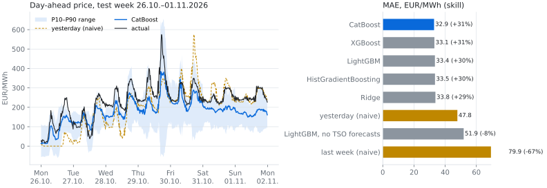
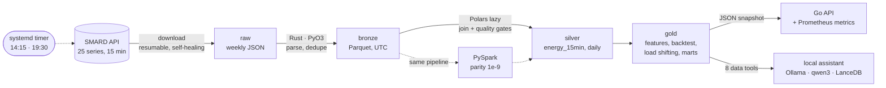

# Ruhrwatt


**English** · [Deutsch](README.de.md)

Day-ahead electricity prices and load-shifting savings for NRW industry, built on public
SMARD data: a Rust parser, Polars pipelines with quality gates, a Spark version proven
identical, forecasting models, a local German-speaking assistant and a small Go API.
It refreshes itself twice a day.

- **Forecast:** CatBoost predicts tomorrow's quarter-hour prices with a **mean error of
  31.3 EUR/MWh, 36 % lower than "same as yesterday"** (walk-forward backtest, retrained
  weekly, 8 models on identical rows). Its P10–P90 range holds 77 % of actual prices
  (target 80 %). Without the grid operators' wind and solar forecasts, the best model is no
  better than the baseline: that is where the skill comes from.
- **Speed:** the Rust bronze parser is **9× faster** than the same logic in Python + pyarrow
  (350 k rows, 2 cores; `make bench`), with outputs checked for equality before timing.
- **Spark:** the PySpark pipeline matches Polars to 1e-9 on every table. On one machine,
  Polars is still 7–44× faster, which is why it is the default.
- **Assistant:** a local qwen3:14b answers German questions through 8 data tools. It gave
  26 of 28 test answers fully right, none wrong, and every number is checked against tool
  output.



## Architecture



| Layer | What happens | Code |
|---|---|---|
| raw | Weekly SMARD files, atomic writes, re-fetch of weeks SMARD is still filling | `download/` |
| bronze | Rust core parses, sorts, dedupes and counts gaps in parallel; typed Parquet | `crates/`, `bronze/` |
| silver | 25 series joined on a continuous 15-min grid; gates stop bad data (price range, PV dark at night, forecasts correlate with actuals, ...) | `silver/` |
| gold | DST-safe lag features without look-ahead, walk-forward model comparison, optimal within-day load shifting, monthly market mart | `gold/` |
| serving | Go API (stdlib only, distroless image) and the RAG assistant read from gold | `api/`, `rag/` |

## Quick start

Needs [uv](https://docs.astral.sh/uv/) and [rustup](https://rustup.rs); `uv sync` compiles the
Rust extension. Spark needs Java 17/21, the assistant [Ollama](https://ollama.com) with ≤ 16 GB VRAM.

```bash
uv sync && uv run pytest -m "not spark"   # build + offline tests
make smard-all                            # download all series since 2025-01-01
make pipeline                             # bronze -> silver -> gold -> serving snapshot
make backtest                             # model comparison; then `make readme-chart`
make ask Q="Wann war der Strom gestern am billigsten?"
make api PORT=8090 && make api-check PORT=8090
```

<details>
<summary>All commands</summary>

```bash
make bronze | silver | gold    # single layers
make lab                       # JupyterLab; start with notebooks/01_explore_silver.ipynb
make spark                     # silver + gold features with PySpark -> data/spark
make spark-parity              # proves Spark and Polars produce identical tables
make bench                     # Rust vs pure-Python parser
make bench-spark               # Polars vs Spark on 2 / 10 / 25 years of synthetic data
make rag-setup && make rag-index   # pull models, embed the docs
make chat | rag-eval | rag-batch   # interactive, eval with known answers, German question set
make up                        # Docker; profiles in docs/devops.md
make timer-install             # daily refresh at 14:15 and 19:30 Berlin (systemd user timer)
make readme-chart              # docs/img/backtest.svg from the latest backtest
```

</details>

<details>
<summary>Repository layout</summary>

```
src/ruhrwatt/
  cli.py              `ruhrwatt smard|silver|gold|spark|rag ...`
  download/smard.py   raw SMARD downloader (resumable, atomic writes, self-healing re-fetch)
  bronze/smard.py     raw -> bronze Parquet via the Rust core
  bronze/reference.py pure-Python oracle for the tests and the benchmark baseline
  silver/energy.py    bronze -> energy_15min + energy_daily (Polars, lazy)
  silver/gates.py     quality gates (price range, Amprion <= DE, PV dark at night, ...)
  gold/features.py    day-ahead forecasting features (no look-ahead, DST-safe lags)
  gold/backtest.py    walk-forward comparison of 8 models + calibrated P10/P90 ranges
  gold/shift.py       optimal within-day load shifting for NRW plant profiles
  gold/mart.py        gold tables incl. the monthly market mart
  gold/serving.py     JSON snapshots for the Go API
  spark/              PySpark silver + gold features, parity check vs Polars
  rag/                local assistant: Ollama client, data tools, docs index, agent, eval, batch
crates/ruhrwatt-core/ Rust (PyO3): parallel parse, dedupe, quality counters, Parquet writer
api/                  Go: read-only HTTP API over the serving snapshots, Prometheus metrics
benchmarks/           Rust vs Python parser, Polars vs Spark pipeline
notebooks/            01_explore_silver (market), 02_gold_forecast_and_shifting
questions/            question sets for `ruhrwatt rag batch` (fragen_de.json)
deploy/               systemd timer, Prometheus scrape config and alerts
scripts/              daily refresh (pipeline.sh), README chart
docs/                 bronze/silver/gold schema, spark.md, rag.md, devops.md
tests/                pytest, offline (Go tests live in api/)
data/                 raw, bronze, silver, gold, serving; never committed
```

</details>

Deeper reading: [gold schema and backtest](docs/gold_schema.md) ·
[Spark](docs/spark.md) · [assistant](docs/rag.md) · [DevOps](docs/devops.md).

## SMARD notes

- Prices are for the DE-LU bidding zone. SMARD has no NRW-level data, so regional load and
  generation use the **Amprion** control area, which covers most of NRW.
- Always download `quarterhour`. Before 2025-10-01 it repeats each hourly price four times;
  from that date the day-ahead market is natively 15-minute (`is_native_15min` in bronze).
- All 25 series are verified by a live download plus the silver gates (PV dark at night,
  Amprion ≤ Germany, TSO forecasts correlate 0.93–0.996 with their actuals).
  `ruhrwatt smard probe <filter ids>` checks new filter ids live before registering them.
- SMARD fills weeks with a lag, so unfinished weeks and the newest 2 weeks are re-fetched on
  every run. Tomorrow's prices appear in the afternoon or evening, hence the 19:30 run.
- A DST week has 668 (spring) or 676 (autumn) quarter-hours instead of 672; the parser
  keeps real UTC timestamps, so this needs no special handling.

Figures above are from the author's run on 2025–2026 data and change as data grows.
Data: Bundesnetzagentur | SMARD.de, CC BY 4.0.
